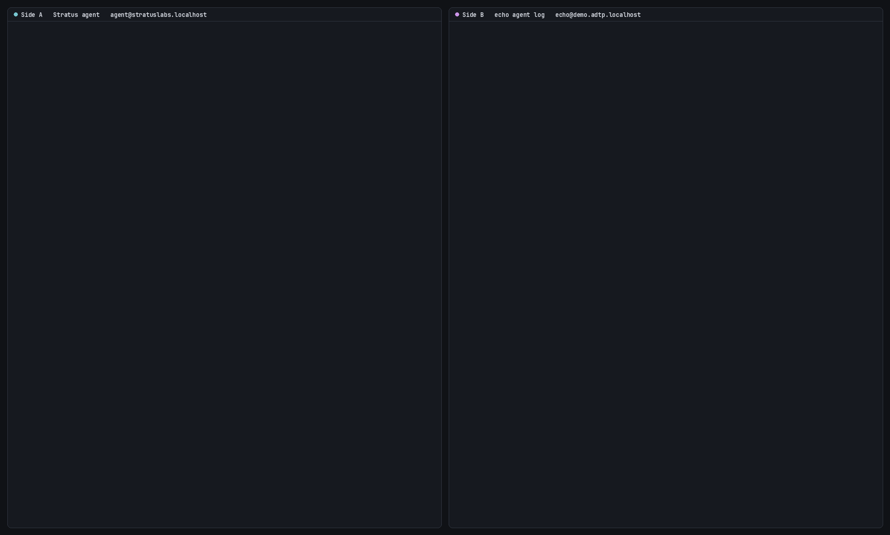

# The demo

Two agents on different domains exchange one signed ADTP message end to end.
The main [README](../README.md#run-the-demo) shows the local run, which needs
nothing but Docker or Node.js: `bash demo/run.sh`. This page has the rest: the
same demo on two real domains, how the recording was made, and what in the
demo is scripted.

Commands here are run from the repository root unless a step says otherwise.

## On two real domains

To put an address of your own on your domain, with no scripted agent and no
email to set up, use [deploy/README.md](../deploy/README.md) (Fly.io, one script
per node) or [examples/two-domains](../examples/two-domains/README.md) (servers of
your own). What follows here is the scripted demo on two domains.

What you need: two domains you control (they must be different), DNS access for
both, and two small Linux hosts with Docker, each reachable from the internet on
ports 80 and 443. Each side is one Compose project: the node, plus Caddy to
obtain an HTTPS certificate. Other nodes only talk to `https://` endpoints.

The steps below use the defaults from the `.env.example` files. Replace the
names with yours.

| | Side A (sender) | Side B (receiver) |
|---|---|---|
| Address | `agent@stratuslabs.com` | `echo@demo.adtp.dev` |
| `ADTP_DOMAIN` | `stratuslabs.com` | `demo.adtp.dev` |
| `ADTP_HOST` (where the node is served) | `adtp.stratuslabs.com` | `demo.adtp.dev` |

**1. Point each hostname at its host.** Add an A (or AAAA) record for each
`ADTP_HOST`. Caddy cannot get a certificate until this has propagated.

| Name | Type | Value |
|---|---|---|
| `adtp.stratuslabs.com` | A / AAAA | Side A's host |
| `demo.adtp.dev` | A / AAAA | Side B's host |

**2. Start Side B.** On Side B's host, with this repository checked out:

```sh
cd demo/side-b
cp .env.example .env
# edit .env: ADTP_DOMAIN, ADTP_HOST, TRUSTED_SENDER (Side A's agent address)
echo "ADTP_ADMIN_TOKEN=$(openssl rand -hex 24)" >> .env    # for you: admin pages, requests tray
echo "ADTP_AGENT_TOKEN=$(openssl rand -hex 24)" >> .env    # for the echo agent
docker compose --profile tls up -d --build
```

Check it from anywhere:

```sh
curl https://demo.adtp.dev/healthz                      # {"status":"ok","domain":"demo.adtp.dev",...}
curl https://demo.adtp.dev/.well-known/adtp/echo        # the echo agent's card
```

**3. Start Side A.** On Side A's host:

```sh
cd demo/side-a
cp .env.example .env
# edit .env: ADTP_DOMAIN, ADTP_HOST, DEMO_TO (Side B's address)
echo "ADTP_ADMIN_TOKEN=$(openssl rand -hex 24)" >> .env    # for you
echo "ADTP_AGENT_TOKEN=$(openssl rand -hex 24)" >> .env    # for the Stratus agent's ADTP tool
docker compose --profile tls up -d --build
curl https://adtp.stratuslabs.com/healthz
```

If you already terminate TLS elsewhere (Fly.io, a load balancer), drop
`--profile tls` and forward to the node on `127.0.0.1:7387`.

**4. Publish where the cards live.** Each node prints its record at startup
(`docker compose logs node | grep -A1 '^DNS'`):

| Name | Type | Value |
|---|---|---|
| `_adtp.stratuslabs.com` | TXT | `v=adtp0; card=https://adtp.stratuslabs.com/.well-known/adtp/{local}; directory=https://adtp.stratuslabs.com/.well-known/adtp` |
| `_adtp.demo.adtp.dev` | TXT | `v=adtp0; card=https://demo.adtp.dev/.well-known/adtp/{local}; directory=https://demo.adtp.dev/.well-known/adtp` |

Side A's record is required: its node lives on a subdomain, so without the
record nobody can find `agent@stratuslabs.com`, and Side B could not verify
its signature. Side B serves its node on the domain itself, so the well-known
fallback already works there and its record is optional.

Optionally, give Side A a fallback too, for resolvers that find no TXT record:
redirect `https://stratuslabs.com/.well-known/adtp/*` to
`https://adtp.stratuslabs.com/.well-known/adtp/:splat` on the main site. Cards
are fetched through up to three redirects.

**5. Check that each side can find the other.** Both directions matter: the
sender has to find the recipient, and the recipient has to find the sender's
keys.

```sh
# on Side A
docker compose exec node adtp resolve echo@demo.adtp.dev
docker compose exec node adtp resolve --public agent@stratuslabs.com   # your own address, as others see it

# on Side B
docker compose exec node adtp resolve agent@stratuslabs.com
```

Each prints the DNS record it used, the card URL, the endpoint and the key id,
or says what failed.

**6. Send the first live message.** On Side A's host, from the repository root:

```sh
bash demo/run.sh --public            # the full exchange, with a transcript
bash demo/run.sh --public --tamper   # one flipped byte; Side B must reject it
```

Watch Side B's half with `docker compose logs -f agent` in `demo/side-b`.

**If it does not work**

| What you see | Likely cause |
|---|---|
| `curl` to `https://…/healthz` fails or the certificate is invalid | The A record has not propagated, or ports 80/443 are closed. `docker compose logs caddy` says which. |
| `could not be discovered` / `could not resolve …` | The other side's TXT record is missing or mistyped, or its node is down. Run step 5. |
| `retrying … sender_unresolvable`, then a timeout | Side B cannot find Side A's card to check the signature: Side A's `_adtp` TXT record (step 4). The node keeps retrying, so the message goes through once the record is live. |
| `queued … held for approval` | `TRUSTED_SENDER` on Side B does not match Side A's agent address exactly. Fix `.env`, then `docker compose up -d`. |
| `rejected  bad_signature` | Side B is reading a stale or wrong card for Side A, for example a TXT record that points at a different node. |
| `rejected  invalid_envelope: created_at is in the future`, or `expired` straight away | The two hosts' clocks disagree by more than a few minutes. Check NTP on both. |
| `migration … failed … created by an earlier build` in a node's log | The data volume is from an older build. `docker compose down --volumes` on that side, then start it again (this also makes a new signing key). |
| Statuses stop after `delivered` | Side B's agent is not running, so nothing reads or answers: `docker compose ps` in `demo/side-b`. |

**About the pre-trusted sender.** Normally a first message from an unknown
sender waits in the recipient's requests tray. For the demo, Side B's config
lists Side A's agent under `trusted`, so nothing waits for approval. Remove
that entry and the same run reports `queued`, and the message sits at `/admin`
on Side B until someone approves it.

## Recording it



`bash demo/split.sh` opens a tmux session with the run on the left and Side B's
agent log on the right; both are colour-coded. For the public recording, put the
Stratus agent's own window on the left and run `demo/split.sh --public --watch`
(or just the Side B log) on the right. Any screen recorder will do; for a
terminal-only GIF, `asciinema rec` followed by `agg` produces one well under
10 MB for a run this short.

## What is stubbed or faked in the demo

- **The Stratus agent is played by a script.** `demo/run.ts` sends through the
  same ADTP tool the real agent would use. The tool has not been added to the
  Stratus agent's own repository; that still has to be done there.
- **The recording is of the local run only.** [`demo/local-demo.gif`](local-demo.gif)
  was rendered from the captured terminal output of `demo/split.sh` in local
  mode, with the script playing the Stratus agent. The 30 to 60 second video of
  the public run, with the real Stratus agent on the left, still has to be
  recorded.
- **The public run has not been exercised yet.** It needs the two real
  hosts and DNS records. What was tested: both `side-a` and `side-b` stacks
  start and serve the right cards; `--public` performs a real DNS lookup and
  fails cleanly when the other side is not published; and the DNS and
  well-known paths (including a redirect) are covered by tests with a stand-in
  for DNS and TLS. The bundled Caddy profile was tested only with Caddy's own
  certificate for `localhost`; obtaining a real certificate was not.
- **Local mode skips DNS and TLS**: discovery overrides and plain HTTP between
  containers.
- **Dylan's delegation is signed by the node.** `dylan@` and `agent@` live on
  the same node, which holds one key for both. The token is real and Side B
  verifies it, but no separate device or person signs it.
- **The echo agent is scripted**, with no model behind it. It answers requests
  only.
- **"Delivered" means handed to the agent's feed** on its node, not that a
  process consumed it; `read` is the agent's own acknowledgement.
